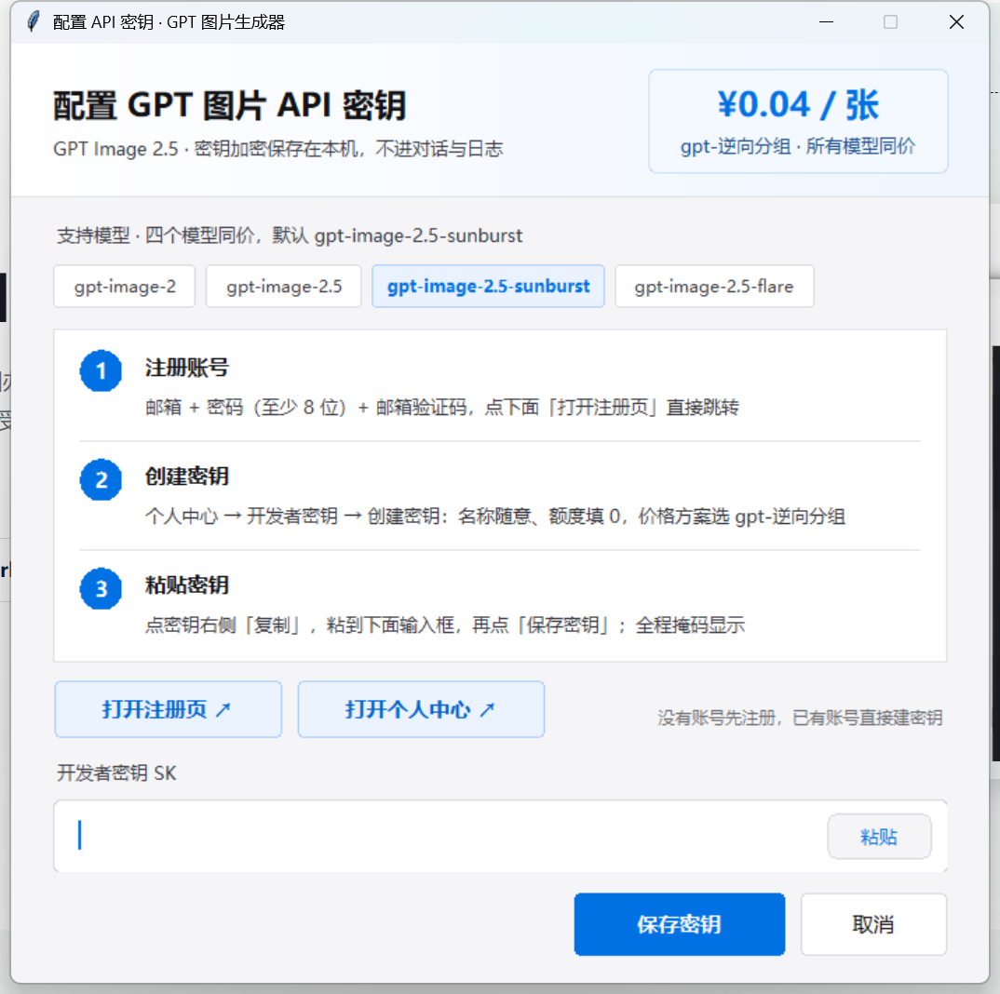

# GPT 图片生成器 · WorkBuddy Skill

基于 **GPT Image 2.5** 的 AI 图片生成与编辑器，直连 `image.aicodeme.xyz` 出图。支持文生图、图生图、图片编辑，密钥通过本地弹窗安全保存，全流程不经过聊天记录与日志。

An AI image generation and editor built on GPT Image 2.5, packaged as a WorkBuddy skill.



## 特点

- **四个模型同一价格**：`gpt-image-2`、`gpt-image-2.5`、`gpt-image-2.5-sunburst`（默认）、`gpt-image-2.5-flare`，**¥0.04 / 张**，画质与尺寸不额外计价
- **密钥本地弹窗**：不用敲命令、不用贴聊天，窗口里粘贴即可；Windows 走 DPAPI，macOS/Linux 走系统钥匙串
- **离线自检**：一条 `selfcheck` 命令即可确认安装完好，不联网、不需要密钥、不消耗额度
- **无桌面不卡死**：服务器 / 容器 / CI 里 `configure-key` 不会挂起，会明确返回退出码 3 并给出替代方案
- **文生图 / 图生图**：编辑模式最多 16 张参考图，单张 ≤ 20 MB
- **画质可选**：`low` / `medium` / `high`（默认）/ `xhigh` / `max`
- 纯 Python 单文件 CLI，无第三方依赖（无 curl 时才需要 `requests`）

## 模型与价格

| 模型 | 说明 | 价格 |
| --- | --- | --- |
| `gpt-image-2` | 基础款 | ¥0.04 / 张 |
| `gpt-image-2.5` | 2.5 系列标准款 | ¥0.04 / 张 |
| `gpt-image-2.5-sunburst` | **默认** | ¥0.04 / 张 |
| `gpt-image-2.5-flare` | 2.5 系列另一分支 | ¥0.04 / 张 |

计费分组为 `image-低价分组`，创建密钥时额度填 `0` 即不限。

## 安装

把仓库放进 WorkBuddy 的技能目录（目录名用 `gpt-image-generator`）：

```bash
# macOS / Linux
git clone https://github.com/ccfwwm/gpt-image-generator.git ~/.workbuddy/skills/gpt-image-generator

# Windows (PowerShell)
git clone https://github.com/ccfwwm/gpt-image-generator.git "$env:USERPROFILE\.workbuddy\skills\gpt-image-generator"
```

重开会话后即可在技能列表里看到它。

## 配置密钥

1. 打开 <https://image.aicodeme.xyz/signup/> 注册
2. 个人中心 →「开发者密钥」→「创建密钥」：名称随意、额度填 `0`、价格方案选 `image-低价分组`
3. 复制密钥
4. 在终端运行下面的命令，弹窗里粘贴并保存

```bash
python scripts/aiimagesee_image.py configure-key
```

四步截图在 [`references/`](references/) 里，也可以直接看 [`references/setup-guide.md`](references/setup-guide.md)。

## 用法

```bash
# 文生图
python scripts/aiimagesee_image.py generate \
  --prompt "极简蓝绿色科技感海报背景，右侧留白给文案" \
  --size 1536x1024 --quality high --out ./poster.png

# 图生图 / 改图
python scripts/aiimagesee_image.py edit \
  --image ./product.jpg \
  --prompt "改成白底电商主图，突出材质与光影" \
  --out ./hero.png

# 其他
python scripts/aiimagesee_image.py selfcheck  # 离线自检：不联网、不需密钥、不消耗额度
python scripts/aiimagesee_image.py config      # 查看配置（不回显密钥）
python scripts/aiimagesee_image.py models      # 查询当前分组可用模型
python scripts/aiimagesee_image.py model set gpt-image-2.5-flare
python scripts/aiimagesee_image.py clear-key   # 删除本机密钥
python scripts/aiimagesee_image.py version     # 打印版本

# 无密钥环境下验证链路（本地渲染一张标注 OFFLINE PREVIEW 的预览图，不调用接口）
python scripts/aiimagesee_image.py generate --offline --prompt "测试" --out ./preview.png
```

尺寸默认 `1536x1024`；长边不超过 3840 px，边长须为 16 的倍数，宽高比不超过 3:1。

在 WorkBuddy 对话里也可以直接用自然语言调用，例如「用 gpt-image-2.5 生成一张详情页长图」。

## 退出码

自动化按退出码判定成败，只有真正的问题才返回非零值。

| 码 | 含义 |
| --- | --- |
| `0` | 命令完成（含「尚未配置密钥」这类友好提示） |
| `1` | 用法错误或参数不合法 |
| `2` | 未配置密钥，无法调用接口 |
| `3` | 当前会话没有桌面，弹不出窗口 |
| `4` | 等待超时被自动中止 |

`--help` / `-h` / `help` / 不带子命令一律返回 `0`；只有未知命令返回 `1`。

无桌面环境（服务器、容器、CI）可以用 `GPT_IMAGE_API_KEY=<密钥>` 仅在本次会话注入密钥，
优先级高于本机已保存的凭证。

## 目录结构

```
gpt-image-generator/
├── SKILL.md                      # 技能定义（frontmatter + 指令正文）
├── _icon.png                     # 技能图标 96×96
├── assets/
│   ├── icon-512.png              # 市场头像 512×512
│   └── icon-source.png           # 图标母版
├── references/
│   ├── api-shape.md              # 接口、字段与凭证说明
│   ├── setup-guide.md            # 密钥获取四步（附截图）
│   └── setup-0*.png|jpg          # 四步截图
├── scripts/
│   └── aiimagesee_image.py       # 单文件 CLI
└── docs/dialog.png               # 弹窗截图
```

## 安全说明

- 密钥只保存在本机凭据库（Windows DPAPI / macOS Keychain / Linux Secret Service 或 KWallet），**不写入任何文件、不进日志、不上传**
- 上游错误信息会自动抹掉密钥内容
- 生成请求失败不会自动重试，避免重复扣费

## 说明

- 依赖第三方服务 `image.aicodeme.xyz`，需要自备 API 密钥，按张计费（¥0.04 / 张，以站内价格为准）
- 版本 `2.4.3` · 作者 程迅科技
